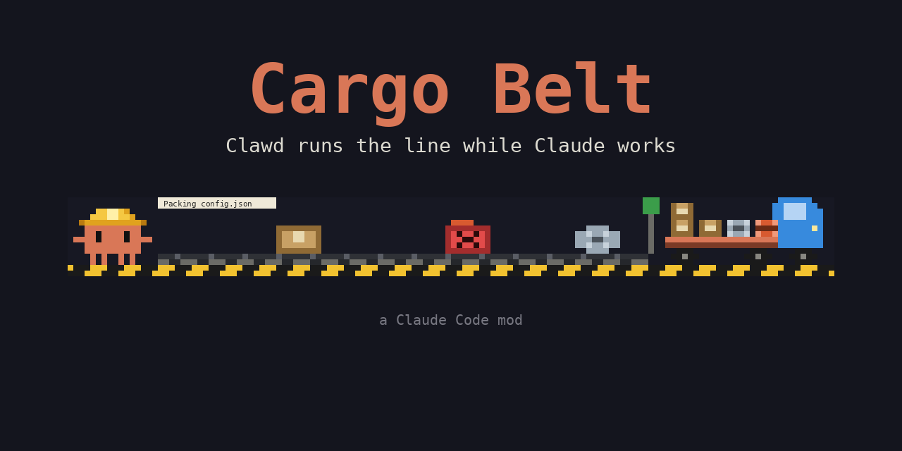
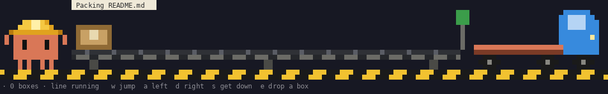

# Cargo Belt



While Claude works, a tiny pixel factory opens right above your prompt. Clawd puts on a yellow hard hat and runs the conveyor belt, every tool call turns into cargo, and when the turn is done the truck drives off with everything Claude made.



| What Claude does | What happens on the line |
| --- | --- |
| Read / Grep / Glob / WebFetch | A cardboard box goes on the belt: `Packing README.md` |
| Edit / Write | A machined metal part goes on the belt: `Machining register.js` |
| Bash / PowerShell | An orange barrel rolls on: `Running npm test` |
| A tool fails | A damaged box falls off the end, the andon light flashes red and the bubble turns red |
| Claude needs your permission or asks a question | The line stops, the andon blinks amber, Clawd waves and the bubble turns amber |
| You answer | `Thanks, moving on!` and a little hop |
| A subagent starts | `A helper joined the line!` |
| The turn ends | Clawd raises a checkered flag, the last items are loaded, and the truck drives off |

Each item hops off the end of the belt into the truck bed in its own color, so a glance at the truck tells you what the turn was made of. Every now and then Clawd whistles a tune or blinks. The next turn, a fresh truck rolls in.

## Play

The band shows `w jump  a left  d right  s get down  e drop a box`. Give the band keyboard focus (click it, or press `Ctrl+X` then `Tab`) and Clawd is yours for a few seconds:

| Key | What Clawd does |
| --- | --- |
| `w` | Jumps. Land on the belt and it carries you toward the truck, then pushes you off the end. |
| `a` / `d` | Walks left / right |
| `s` | Gets off the belt |
| `e` | Drops a box on the belt by hand. It counts toward the shipment. |

Press `Esc` to give the keyboard back to the prompt. Leave Clawd alone and he walks back to his station. Arrow keys and the space bar can't be mod hotkeys in Claude Code, which is why the controls are letters.

## Install

Requires Claude Code **2.1.287** or later (`claude update`). Inside Claude Code:

```
/plugin marketplace add KemalHub/cargo-belt
/plugin install cargo-belt@cargo-belt
```

Turn it on or off with `/cargo`. Want it smaller? `/cargo-size` switches to small pixels (your terminal font needs Unicode sextant characters, such as Cascadia Mono). Both choices are remembered.

For a local install from a clone:

```
/plugin marketplace add ./cargo-belt
/plugin install cargo-belt@cargo-belt
```

## Preview without Claude

Watch a scripted shift in your own terminal, no Claude Code needed (Node 18+ and a truecolor terminal):

```
node tools/preview.mjs        # 136 columns
node tools/preview.mjs 100    # narrower
```

## Development

```
claude plugin validate ./plugin --strict   # check the manifest and hooks module
claude --plugin-dir ./plugin               # load it for one session, reloads on save
```

## How it works

- Hooks on `tool.call`, `tool.check`, `agent.spawn`, `turn.start` and `turn.complete` turn Claude's work into events on the line.
- The scene is drawn into the band above the prompt (`AbovePrompt`) as a truecolor `Raster`. Big mode (the default) uses half blocks, 1x2 pixels per cell: 8 rows for the scene and 1 for the status line. Small mode packs 2x3 pixels into each cell with Unicode sextant characters: 6 rows plus the status line.
- It fits the terminal width (70 to 200 columns), runs at a fixed speed on any monitor, and hides itself a few seconds after the turn ends.
- The Desktop app has no `Raster`, so it shows a one-line status there instead.
- No model calls, no network, no file access. The only stored value is whether the belt is on.

## Credits

Clawd is Anthropic's mascot; this is an unofficial fan mod. Inspired by [Clawd Madenci](https://github.com/selmakcby/clawd-madenci).

## License

MIT, see [LICENSE](LICENSE).
